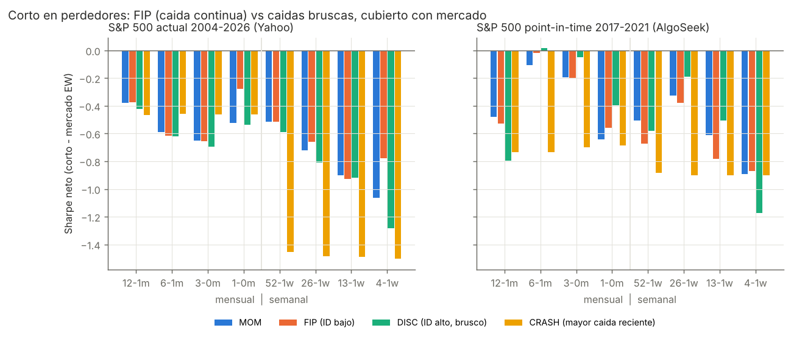
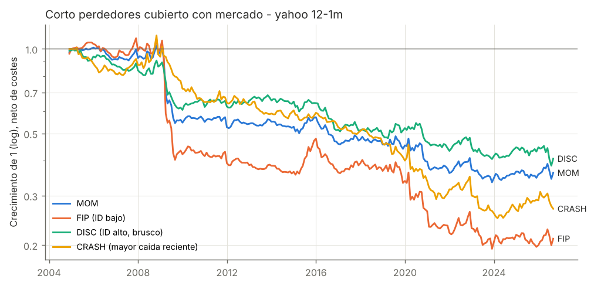
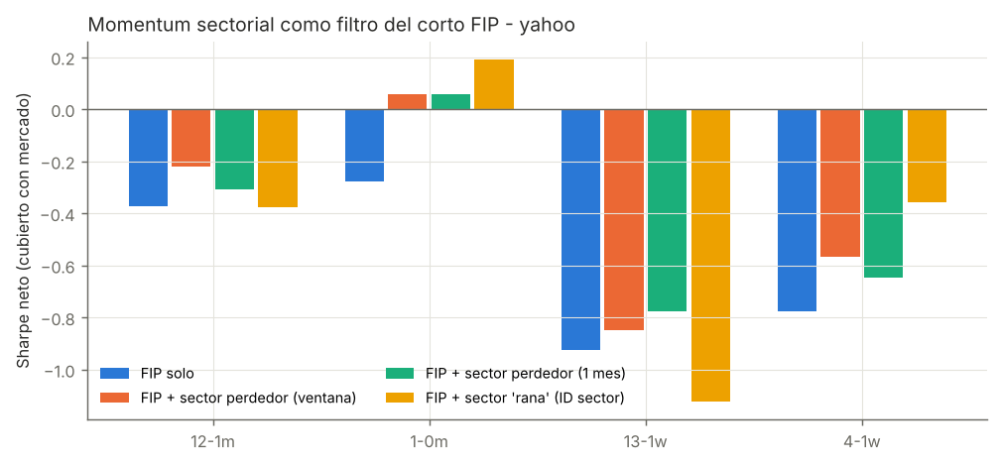
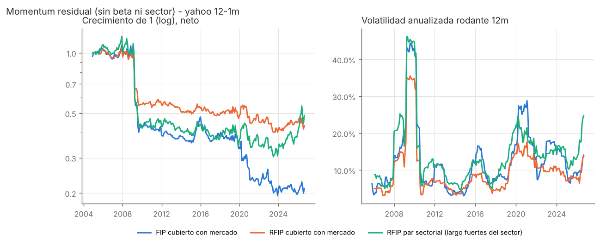
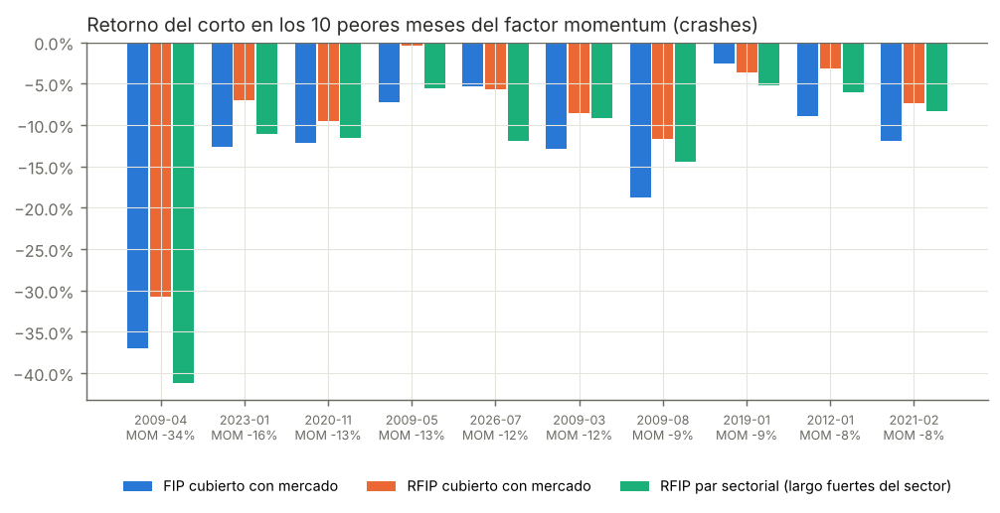
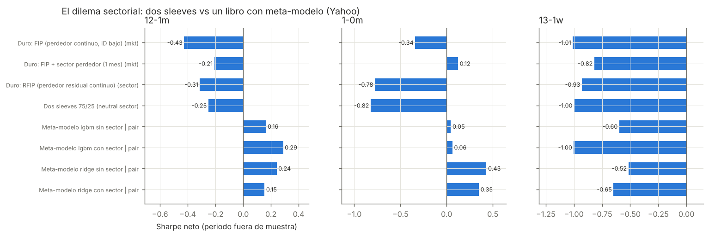

# "Frog in the pan" en cortos: ¿es mejor ponerse corto en la caída continua o en la caída brusca?

Análisis de estrategias cortas de horizonte **semanal y mensual** sobre acciones del S&P 500,
comparando la teoría *frog in the pan* (FIP, Da, Gurun y Warachka 2014) con el corto en las
acciones que caen de forma más brusca. Incluye el uso de la información sectorial como **señal**
(momentum de industria, difusión lenta líder→rezagado y cliente→proveedor) y como **control de
riesgo** (momentum residual), y las dos soluciones al dilema sectorial (dos sleeves vs meta-modelo).

Código en `src/`, resultados completos en `results/` (todas las tablas en `results/tables.md`,
la parrilla completa en `results/grid_stats.csv`) y gráficos en `figures/`.

---

## 1. Resumen ejecutivo

| Pregunta | Respuesta corta |
|---|---|
| ¿FIP es mejor que cortar las caídas **bruscas**? | **Sí, frente a las caídas por salto** (la mayor caída de 1 día: FIP gana +2 a +6,5 pp/año brutos en las 16 combinaciones de ventana×muestra, t de hasta 3,1) **y frente a la mayor caída reciente** a horizonte semanal o de 1 mes (+2,6 a +11,6 pp/año en semanal, t de hasta 3,7). Los valores que se desploman de golpe **rebotan** y son el peor corto posible. |
| ¿FIP es mejor que el momentum corto clásico o que los perdedores de ID alto? | **No.** Frente al quintil perdedor (MOM) o los perdedores "discretos" de ID alto (DISC), la diferencia es pequeña, de signo variable y casi nunca significativa. En grandes valores del S&P 500 el efecto FIP *dentro* de los perdedores no aparece. |
| ¿Gana dinero el corto de momentum en sí? | **No, después de costes**, en ninguna de las dos muestras: Sharpe neto entre −0,3 y −0,9 cubriendo con el mercado. Parte es sesgo de supervivencia en la muestra larga, pero también pierde en la muestra *point-in-time* 2017-2021. |
| ¿Semanal o mensual? | **Mensual.** En semanal la rotación (36-85 % por semana) cuesta 5-10 pp/año y la reversión a 1 semana castiga a los cortos. |
| Sector como **señal** | El doble filtro (FIP dentro de sector perdedor) **mejora** el FIP mensual: Sharpe −0,28 → +0,06 en Yahoo 1 m, y +0,19 si el sector también cae de forma gradual (ID sectorial bajo). Pero lo hace con la mitad de nombres y más volatilidad, y el momentum sectorial puro (11 sectores GICS) **no** funciona solo. |
| Difusión lenta | **Existe en la muestra larga.** Líderes → rezagados: t=2,0 (mensual). Clientes → proveedores: t=1,9 (mensual) y 2,6 (semanal). Condicionar mejora mucho el corto relativo, pero no lo vuelve rentable en este universo. |
| Momentum **residual** (control de riesgo) | **Confirmado**: la volatilidad baja ~25-45 %, la β al factor momentum ~40 %, el MaxDD pasa de −82 % a −62 % y las pérdidas en los crashes de momentum se reducen ~40 % (FIP −13,6 % → RFIP −8,4 % de media). |
| Cobertura "a lo Darwinex" con largos fuertes del sector | **Cuidado**: comprar las fuertes del sector **duplica la apuesta a momentum** (β MOM 0,8 → 1,0, más pérdidas en crashes: −41 % en abril de 2009). Mejor cubrir con la cesta del sector o con largos elegidos por otra señal. |
| Dilema: ¿dos sleeves o meta-modelo? | El **meta-modelo** es lo único con Sharpe neto **positivo** fuera de muestra a horizonte mensual (0,15-0,43; ridge 6-1 m t=2,0, 1-0 m t=1,95). Las variables sectoriales **no** aportan de forma robusta. Los dos sleeves no arreglan nada porque el sleeve sectorial pierde. |

**Conclusión práctica.** Si vas a cortar, corta la **caída continua** (FIP) y **nunca** la caída
brusca de un día. Hazlo **mensual**, sobre el **retorno residual** (sin beta ni sector) para
sobrevivir a los crashes de momentum. Usa el sector y la cadena de suministro como **features**
de un modelo de ranking, no como filtros duros. Y no esperes que el corto de momentum en grandes
valores de EE. UU. sea por sí solo una fuente de alfa: su valor está en ser una cobertura con
expectativa cercana a cero, o en combinarse con un meta-modelo.

---

## 2. Datos (del repositorio ML4T y sus librerías)

| Muestra | Fuente | Periodo | Universo | Sesgo |
|---|---|---|---|---|
| **AlgoSeek PIT** | `data/equities/market/sp500/daily_bars.parquet` del repo [stefan-jansen/machine-learning-for-trading](https://github.com/stefan-jansen/machine-learning-for-trading) | 2017-01 a 2021-12 | 638 valores, miembros del S&P 500 **día a día** (~505) | Sin sesgo de supervivencia. `close × adj_factor` = precio de retorno total (splits y dividendos) |
| **Yahoo larga** | Yahoo Finance (el proveedor de `ml4t-data`), `src/download_long_sample.py` | 2004-01 a 2026-09 | 514 miembros **actuales** del S&P 500 | **Con sesgo de supervivencia** (ver §8) |
| Factores | Ken French vía `ml4t.data.providers.fama_french.FamaFrenchProvider` | diario | FF5 + MOM | – |
| Sectores | GICS de Wikipedia (miembros actuales) + mapeo manual de los 223 que salieron (`data/sector_map_supplement.csv`) | estático | 11 sectores | Clasificación actual, no histórica |
| Cliente→proveedor | Mapa curado a mano a partir de las divulgaciones de "major customers" de los 10-K (`src/data.py: CUSTOMER_SUPPLIER`) | estático | ~45 proveedores | Ilustrativo. El grafo extraído por LLM del capítulo 23 del repo resultó demasiado ruidoso (p. ej. "AbbVie → proveedor TSMC") |

El dataset sin sesgo y con más historia del repo (`us_equities`, Quandl WIKI 1962-2018) requiere una
API key gratuita de NASDAQ Data Link que no estaba disponible en este entorno. Es el siguiente paso
natural (§10).

---

## 3. Metodología

**Señales** (`src/signals.py`). Todas se calculan con información disponible al cierre del día de rebalanceo.

* **PRET**: retorno acumulado de la ventana de formación.
* **ID** (*information discreteness*) = `signo(PRET) × (%días negativos − %días positivos)`. En un perdedor, un ID bajo (muy negativo) significa que la caída llegó en muchos días pequeños: la **rana en la olla**. Un ID alto significa que la caída se concentró en pocos saltos grandes: información **discreta** o brusca.
* Ventanas **mensuales**: 12-1, 6-1, 3-0 y 1-0 meses. **Semanales**: 52-1, 26-1, 13-1 y 4-1 semanas (siempre saltando la última semana).
* **Residual**: β al mercado EW y al sector (sector − mercado), estimadas sin constante con 252 días. El residuo da `rPRET = Σe/σ(e)` (Blitz, Huij y Martens 2011) y `rID` sobre los signos de e.
* **Sector**: índice EW de cada sector GICS. Sobre él se calcula su PRET, su retorno a 1 mes y su **ID sectorial** (un sector que cae de forma gradual es otra rana en la olla).
* **Líder→rezagado**: dentro de cada sector, el 30 % con mayor volumen en dólares (63 días, aproximación al tamaño) son los líderes y el 30 % menor, los rezagados. La señal es el retorno de los líderes en el último periodo.
* **Cliente→proveedor**: retorno a 1 mes de la cesta de clientes de cada proveedor.

**Carteras cortas** (equiponderadas, rebalanceo al cierre del último día de mes o de semana):

| Nombre | Definición |
|---|---|
| MOM | quintil inferior de PRET |
| **FIP** | MOM ∩ tercil de **ID más bajo** (caída continua) |
| DISC | MOM ∩ tercil de **ID más alto** (caída brusca según DGW) |
| JUMP | MOM ∩ tercil con la **peor caída de un solo día** |
| CRASH | decil con la **mayor caída en el último periodo** (mes o semana) |
| FIP + sector… | FIP ∩ sector entre los 3 peores (misma ventana / 1 mes) o sector "rana" (PRET<0 e ID sectorial bajo) |
| RMOM / RFIP / RDISC | igual que las anteriores, sobre rPRET / rID |
| Rezagados con líderes débiles | rezagados de los 3 sectores cuyos líderes cayeron más |
| Proveedores con clientes débiles | proveedores en el tercil con peor retorno de clientes |

**Coberturas**:
* **mercado**: largo en el universo EW.
* **sector EW**: largo en la cesta EW de los mismos sectores, con los mismos pesos sectoriales que el corto.
* **par**: largo en el quintil más fuerte dentro de cada sector shorteado. Es la cobertura propuesta para Darwinex sin CFD de ETFs sectoriales.

**Costes**: 10 pb por unidad de nocional operado en cada pata, más 1 %/año de préstamo o financiación del corto. Se muestran también resultados brutos (`ls_bruto`).

**Evaluación**: Sharpe, t de Newey-West, alfa FF5+MOM, β al factor MOM, MaxDD, asimetría y retorno medio en los **10 peores periodos del factor momentum** (crashes).

---

## 4. Resultado central: FIP vs caídas bruscas



**Yahoo 2004-2026, 12-1 meses, cubierto con mercado, neto:**

| Estrategia | Ret %/a | Vol %/a | Sharpe | Alfa FF6 %/a | β MOM | MaxDD % | Crashes MOM % |
|---|---:|---:|---:|---:|---:|---:|---:|
| MOM (quintil perdedor) | −4,0 | 10,7 | −0,38 | −5,3 | 0,59 | −67,5 | −9,4 |
| **FIP (ID bajo)** | −5,8 | 15,4 | −0,37 | −7,8 | 0,79 | −82,2 | −13,6 |
| DISC (ID alto) | −3,7 | 8,8 | −0,42 | −4,5 | 0,42 | −61,5 | −6,1 |
| JUMP (peor día) | −10,3 | 15,6 | −0,66 | −11,6 | 0,71 | −92,4 | −13,4 |
| CRASH (mayor caída último mes) | −5,3 | 11,4 | −0,47 | −4,4 | 0,28 | −77,7 | −6,9 |

**Test directo**: retorno del corto FIP menos el del corto rival, bruto. Cada celda es la diferencia en % anual con la t de Newey-West entre paréntesis.

| | 12-1m | 6-1m | 3-0m | 1-0m | 52-1w | 26-1w | 13-1w | 4-1w |
|---|---|---|---|---|---|---|---|---|
| Yahoo FIP − JUMP | **4,9 (3,1)** | **6,0 (3,0)** | 2,0 (1,1) | **5,6 (2,9)** | **6,0 (3,1)** | **6,5 (2,8)** | 3,5 (1,8) | **6,3 (2,8)** |
| Yahoo FIP − CRASH | −1,5 (−0,5) | −2,7 (−1,0) | −3,5 (−1,5) | **2,6 (2,1)** | 6,2 (1,7) | 6,6 (1,95) | 4,7 (1,5) | **11,6 (3,7)** |
| Yahoo FIP − DISC | −2,2 (−1,0) | −1,3 (−0,7) | −2,4 (−1,1) | 1,8 (0,9) | −2,1 (−0,8) | 0,0 (0,0) | −1,7 (−0,7) | **5,8 (2,7)** |
| Yahoo FIP − MOM | −1,3 (−1,0) | −1,3 (−1,1) | −1,9 (−1,4) | 1,5 (1,3) | −0,8 (−0,6) | 0,6 (0,4) | −1,1 (−0,8) | **3,6 (3,0)** |
| AlgoSeek FIP − JUMP | 1,8 (0,5) | 4,9 (1,2) | 3,6 (1,0) | 5,8 (1,4) | 4,1 (0,7) | 5,0 (1,0) | 1,8 (0,4) | 0,1 (0,0) |
| AlgoSeek FIP − CRASH | −0,7 (−0,1) | **8,9 (2,3)** | 5,8 (1,4) | 3,0 (1,5) | −3,2 (−0,3) | 4,1 (0,5) | −1,3 (−0,2) | 2,2 (0,3) |
| AlgoSeek FIP − DISC | −2,1 (−0,4) | −0,5 (−0,1) | −2,5 (−0,5) | −2,2 (−0,8) | −4,2 (−0,6) | −3,7 (−0,9) | −5,2 (−1,1) | 1,8 (0,6) |

**Lectura:**
1. **"Caer de golpe" es el peor corto.** Los perdedores con la mayor caída de un día (JUMP) rinden peor que los FIP en **las 16 combinaciones**. En la muestra larga la diferencia es de 2-6,5 pp/año y significativa en 6 de 8 ventanas. Es coherente con la sobrerreacción a noticias discretas y con el *gap reversal*.
2. **La mayor caída reciente revierte a corto plazo.** El decil que más cayó la última semana o el último mes (CRASH) es especialmente malo a horizonte semanal, por la reversión de corto plazo de Lehmann y Jegadeesh. Con ventanas largas (3-12 meses) la diferencia desaparece.
3. **El efecto FIP de DGW (FIP mejor que DISC dentro de los perdedores) no aparece** en grandes valores del S&P 500. Lo esperable: DGW lo documentan en el universo CRSP completo, y en *large caps* con alta cobertura de analistas la atención limitada pesa menos.
4. **FIP concentra más riesgo de crash**: β MOM 0,79 frente a 0,42 de DISC, y −37 % en abril de 2009. La caída continua es justo lo que más rebota cuando el mercado gira (los "perdedores de alta beta").



---

## 5. El sector como señal

### 5.1 Momentum sectorial y doble filtro



| Yahoo, neto, cubierto con mercado | 12-1m Sharpe | 1-0m Sharpe | Nº cortos (1-0m) |
|---|---:|---:|---:|
| FIP solo | −0,37 | −0,28 | 30 |
| FIP + sector perdedor (ventana o 1 mes)¹ | −0,22 / −0,31 | **+0,06** | 14 |
| FIP + sector "rana" (sector PRET<0 e ID sectorial bajo) | −0,38 | **+0,19** | 16 |
| Momentum sectorial L/S 3 vs 3 (1 mes) | −0,17 | −0,16 | – |
| *AlgoSeek 1-0m: FIP → FIP + sector "rana"* | | −0,56 → **+0,11** | 16 |

¹ Con ventana de 1 mes, "misma ventana" y "1 mes" coinciden.

* El **doble filtro mejora el FIP** a 1 mes en ambas muestras. La mejor variante es la que tú proponías, **sector que también cae de forma gradual**: Sharpe +0,19 en Yahoo y +0,11 en AlgoSeek. A cambio, la volatilidad sube de ~10 % a ~16 % porque la cartera tiene la mitad de nombres.
* En 12-1 meses el filtro ayuda poco, y en semanal no ayuda (los costes dominan).
* El **momentum sectorial puro con 11 sectores GICS no funciona** en 2004-2026 (Sharpe −0,16 a −0,24). Moskowitz y Grinblatt usan unas 20 industrias más finas, y el efecto se ha debilitado tras su publicación. Para replicarlo bien harían falta industrias o subindustrias GICS históricas.

### 5.2 Difusión lenta

**Fama-MacBeth** (coeficiente del retorno del líder o del cliente en el periodo t sobre el retorno en t+1):

| Muestra | Test | coef | t NW |
|---|---|---:|---:|
| Yahoo mensual | líder → rezagado (sector) | 0,050 | **2,04** |
| Yahoo mensual | cliente → proveedor | 0,041 | **1,92** |
| Yahoo semanal | líder → rezagado | 0,021 | 1,45 |
| Yahoo semanal | cliente → proveedor | 0,013 | **2,60** |
| AlgoSeek (mensual/semanal) | ambos | 0,01-0,04 | <1,2 (solo 5 años) |

Los signos coinciden con Hou (2007) y Cohen y Frazzini (2008). Como estrategia corta (Yahoo 1-0m):

| | Sharpe neto |
|---|---:|
| Rezagados (todos) | −1,74 |
| **Rezagados con líderes débiles** | **−0,55** |
| Proveedores (todos) | −0,16 |
| **Proveedores con clientes débiles** | **+0,04** |

El condicionamiento a líderes o clientes débiles **mejora mucho** el corto. Con todo, el corto
absoluto sigue en negativo, en buena parte por el sesgo de supervivencia: los "pequeños" del
S&P 500 de hoy fueron, por construcción, ganadores. En **autos** (GM, F → APTV, BWA, DLPH, GT) el
mapa es pequeño y no permite un test aislado, pero tu conocimiento del sector es justo lo que
permitiría ampliar el grafo cliente→proveedor, que es la parte con más señal.

---

## 6. El sector como control de riesgo: momentum residual



| Yahoo 12-1m, neto | Vol %/a | Sharpe | β MOM | MaxDD % | Crashes MOM % |
|---|---:|---:|---:|---:|---:|
| MOM, cubierto con mercado | 10,7 | −0,38 | 0,59 | −67,5 | −9,4 |
| **RMOM**, cubierto con mercado | **7,2** | −0,23 | **0,36** | **−42,2** | **−5,1** |
| FIP, cubierto con mercado | 15,4 | −0,37 | 0,79 | −82,2 | −13,6 |
| **RFIP**, cubierto con mercado | **11,6** | −0,27 | **0,50** | **−61,9** | **−8,4** |
| RFIP, par (largo fuertes del sector) | 16,9 | −0,10 | 0,85 | −74,9 | −12,5 |

En AlgoSeek 12-1m (*point-in-time*) el RFIP pasa a Sharpe **+0,12** (FIP −0,53), con la volatilidad bajando de 19,4 % a 11,2 % y el MaxDD de −42 % a −20 %.



* **Se confirma Blitz, Huij y Martens**: quitar beta y sector reduce la volatilidad entre un 25 % (FIP) y un 33 % (MOM), la exposición al factor momentum ~40 % y las pérdidas medias en los 10 peores meses del momentum ~40 %. Los rebotes violentos de los perdedores (abril de 2009, noviembre de 2020, enero de 2023) son sectoriales o de beta alta, y el residual los esquiva en parte.
* **La cobertura con las fuertes del sector (par) es un arma de doble filo.** Mejora el Sharpe en la muestra larga, pero **aumenta** la volatilidad y la exposición al momentum (β MOM 0,85-1,03). Un par "corto perdedor / largo ganador" es momentum puro, y en abril de 2009 perdió un 41 %. Si en Darwinex cubres con largos del mismo sector, elige esos largos por algo **distinto** del momentum (cesta del sector, baja volatilidad o predicción del modelo) o dimensiona pensando en los crashes.

---

## 7. El dilema: dos sleeves vs un libro con meta-modelo



* **Dos sleeves**: corto RFIP neutral al sector más una pierna de momentum sectorial L/S 1 mes, cada uno con objetivo de volatilidad (vol realizada de los 12 periodos anteriores) y presupuesto de riesgo 75/25. **No funciona** aquí, porque el sleeve sectorial tiene Sharpe −0,27 y no diversifica lo bastante. 12-1m: −0,25 (neutral) / −0,06 (par).
* **Un libro con meta-modelo** (walk-forward: entrenamiento expansivo, reentreno anual, sin mirar al futuro). Variables en rango transversal: PRET, ID, peor día, último retorno, volatilidad, rPRET, rID, cliente, líder o rezagado y, opcionalmente, PRET, ID y retorno a 1 mes del sector y retorno de los líderes. El objetivo es el rango del retorno siguiente. Se ponen cortos en el quintil inferior de la predicción y se cubren con el quintil superior del mismo sector.

| Yahoo, Sharpe neto fuera de muestra 2008-2026 | 12-1m | 6-1m | 1-0m |
|---|---:|---:|---:|
| Filtro duro FIP (mercado) | −0,43 | −0,67 | −0,34 |
| Filtro duro FIP + sector perdedor 1 m | −0,21 | −0,22 | +0,12 |
| Dos sleeves 75/25 (neutral sector) | −0,25 | −0,25 | −0,82 |
| Meta-modelo ridge **sin** sector, par | **0,24** | **0,42** (t 2,0) | **0,43** (t 1,95) |
| Meta-modelo ridge **con** sector, par | 0,15 | 0,19 | 0,35 |
| Meta-modelo LightGBM **con** sector, par | **0,29** | 0,13 | 0,06 |
| Meta-modelo LightGBM **sin** sector, par | 0,16 | 0,09 | 0,05 |

* El **meta-modelo es claramente mejor que cualquier filtro duro**: pasa de Sharpe −0,2/−0,7 a +0,15/+0,43. Además su pata larga no está elegida por momentum, así que no dobla la apuesta y su retorno medio en los crashes es ≈0 en lugar de −5 % a −14 %.
* **Las features sectoriales no aportan de forma robusta**: con ridge empeoran algo, con LightGBM mejoran en 12-1m. Es decir, el modelo no necesita la etiqueta "sector perdedor" si ya tiene el residual y el ID.
* En **semanal** todo es negativo después de costes, y en AlgoSeek semanal (solo ~51 semanas fuera de muestra) también.

---

## 8. Sesgo de supervivencia: cuánto pesa

Mismas estrategias, mismo periodo (2017-12 a 2021-11), dos universos:

| 12-1m, bruto | Retorno anual de los perdedores (AlgoSeek PIT) | (Yahoo actuales) |
|---|---:|---:|
| MOM | 20 % | 24 % |
| FIP | 23 % | 29 % |
| CRASH | 24 % | 29 % |

Los perdedores de la muestra "actual" rinden **3-8 pp/año más**: son los que se recuperaron y siguen en el índice. Por tanto, **los resultados absolutos de la muestra larga infravaloran a los cortos**. Las comparaciones relativas (FIP vs JUMP o CRASH, residual vs bruto, meta-modelo vs filtro) son más fiables, aunque no inmunes. 2017-2021 fue además un periodo malo para los cortos de momentum: el rally de 2020-21 llevó a los perdedores a ganar un 20 %+ anual.

---

## 9. Recomendaciones para implementar (Darwinex o similar)

1. **Horizonte mensual**, formación 6-1 o 12-1 meses, más una variante de 1 mes con filtro sectorial. Descartar el semanal salvo con costes muy bajos.
2. **Ranking sobre el retorno residual** (sin beta ni sector) e **ID residual**: reduce a la mitad el riesgo de crash.
3. **Nunca shortear tras un desplome de 1 día** (JUMP) ni el top de caída de la última semana (CRASH): excluirlos explícitamente del corto es probablemente el uso más claro del ID.
4. **Sector y cadena de suministro como features** de un meta-modelo, no como filtros duros. Ampliar el mapa cliente→proveedor (autos y semis) es donde tu conocimiento sectorial puede añadir señal.
5. **Cobertura**: preferir la cesta del sector, o largos elegidos por el modelo, frente a "las más fuertes por momentum". Si solo hay acciones, limitar la β al factor MOM del libro.
6. **Gestión de riesgo**: objetivo de volatilidad con la vol realizada y vigilancia de los crashes de momentum (rallies tras mercados bajistas: 2009, noviembre de 2020, enero de 2023).

## 10. Limitaciones y siguientes pasos

* **Muestra sin sesgo y larga**: ejecutar `data/equities/market/us_equities/download.py` del repo ML4T con una API key gratuita de NASDAQ Data Link (WIKI 1962-2018) y añadir clasificación SIC/GICS histórica.
* **Industrias más finas** (GICS sub-industry históricas o las 49 industrias de Fama-French) para el momentum de industria.
* **Grafo cliente→proveedor completo** (Compustat Segments / FactSet Revere) en lugar de un mapa manual.
* **Tamaño real** (capitalización) en lugar de volumen en dólares para líder→rezagado.
* **Costes y financiación de CFD de Darwinex** reales (el swap de cortos varía por valor) y restricciones de *borrow*.

---

### Reproducir

```bash
git clone --depth 1 https://github.com/stefan-jansen/machine-learning-for-trading external/machine-learning-for-trading
pip install pandas numpy pyarrow statsmodels scikit-learn lightgbm matplotlib yfinance ml4t-data tabulate lxml
python src/download_long_sample.py          # muestra Yahoo (~5 min)
python -c "from ml4t.data.providers.fama_french import FamaFrenchProvider as F; p=F(cache_path='data/ff'); [p.fetch(d, frequency=f) for d in ('ff5','mom') for f in ('daily','monthly')]"
cd src
python run_grid.py       # parrilla completa (16 combinaciones × 20 estrategias × 3 coberturas)
python run_tests.py      # tests FIP − rival y sesgo de supervivencia
python run_diffusion.py  # Fama-MacBeth líder→rezagado y cliente→proveedor
python run_combo.py      # sleeves y meta-modelo walk-forward
python make_figures.py && python make_tables.py
```

### Referencias
Da, Gurun y Warachka (2014), *Frog in the Pan*, RFS · Moskowitz y Grinblatt (1999), JF · Hou
(2007), RFS · Cohen y Frazzini (2008), JF · Blitz, Huij y Martens (2011), JEF · Daniel y Moskowitz
(2016), *Momentum Crashes*, JFE · Jansen, *Machine Learning for Trading* (repo de datos y librerías).
