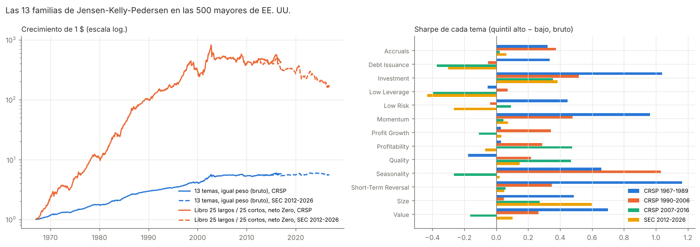
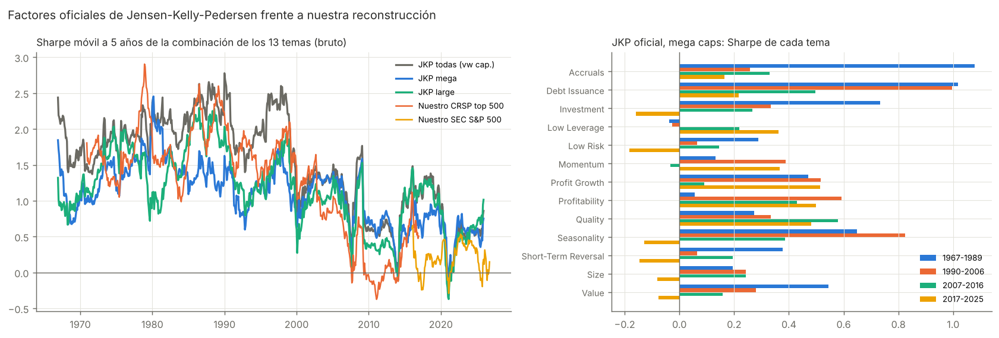

# Las 13 familias de Jensen-Kelly-Pedersen combinadas en una cartera

Rama `analisis-13-familias-kelly`. Comparte datos con la rama de la estrategia de cortos (enlaces en `data/` y `external/`).

**Objetivo.** Combinar los 13 temas de Jensen, Kelly y Pedersen (2023, *Is There a Replication Crisis in Finance?*) en una sola cartera, sobre un universo parecido al de los CFD de Darwinex (grandes compañías de EE. UU.).

## Datos y construcción

* **CRSP / Chen-Pelger-Zhu, 1967-2016** (`src/kelly_cpz.py`): las 500 mayores por capitalización cada mes, sin sesgo de supervivencia. Cada tema es la media de sus características con signo:

| Tema | Características (CPZ) |
|---|---|
| Accruals | −AC, −OA |
| Debt Issuance | −Δ12m apalancamiento *(aproximación)* |
| Investment | −Investment, −DPI2A, −NOA, −NI |
| Low Leverage | −Lev |
| Low Risk | −Beta, −IdioVol, −Variance, −Resid_Var |
| Momentum | r12_2, r12_7 |
| Profit Growth | Δ12m ROE *(aproximación)* |
| Profitability | PROF, OP, ROE |
| Quality | ROA, ATO, PCM |
| Seasonality | retorno medio del mismo mes en los 5 años anteriores *(calculado)* |
| Short-Term Reversal | −ST_REV |
| Size | −LME |
| Value | BEME, E2P, CF2P, S2P |

* **SEC con composición histórica del S&P 500, 2012-2026** (`src/kelly_sec.py`): mismas definiciones con los datos de la SEC presentados en su fecha (companyfacts) y precios de ml4t-data/AlgoSeek, el mismo pipeline que la estrategia de cortos. La capitalización se toma del *public float*. Size y Value solo cubren un 55 % de las acciones-mes, porque muchas empresas no tienen el *float* en companyfacts.
* **Carteras.** Por tema: quintil alto menos bajo, equiponderado y rebalanceo mensual. Combinadas:
  * media de los 13 temas;
  * inversa de la volatilidad (en CPZ);
  * libro implementable: puntuación compuesta = media de los 13 percentiles, N largos / N cortos, neto de costes de Darwinex Zero (spread medido u 8 pb, comisión, retención del 15 % de los dividendos del lado largo).

## Resultados

| Cartera | CRSP 1967-2016 %/mes (Sharpe) | 1967-89 | 1990-2006 | 2007-16 | SEC 2012-2026 %/mes (Sharpe) |
|---|---:|---:|---:|---:|---:|
| 13 temas, igual peso (bruto) | **0,30 (1,11)**, t 8,0 | 0,40 | 0,31 | 0,05 | 0,02 (0,10) |
| Libro 10/10, neto Zero | 1,46 (0,84) | 2,16 | 1,45 | −0,15 | −0,20 (−0,12) |
| Libro 25/25, neto Zero | 1,12 (0,84) | 1,76 | 0,93 | −0,04 | −0,43 (−0,35) |
| Libro 50/50, neto Zero | 0,93 (0,87) | 1,42 | 0,86 | −0,08 | −0,25 (−0,26) |

Rotación del libro: 45-63 % al mes (Short-Term Reversal y Seasonality cambian cada mes).

**Por tema.** En CRSP hasta 2006 destacan Investment, Momentum, Short-Term Reversal, Seasonality y Value (t > 3). Desde 2007, en las 500 mayores, casi ninguno funciona. En la muestra SEC solo Size (t = 2,4, con media cobertura) e Investment (t = 1,5) son positivos. Low Leverage, Low Risk y Debt Issuance salen negativos.

**Selección fuera de muestra.** Si se eligen con datos de 1967-2006 los temas con t > 2 (Accruals, Investment, Momentum, Seasonality, Short-Term Reversal, Size y Value), su combinación da 0,04 %/mes en CRSP 2007-2016 y 0,16 %/mes bruto (Sharpe 0,49, t 1,9) en SEC 2012-2026, casi todo por Size. Con una rotación de ~50 % mensual, los costes se comerían ese margen.

## Comparación con los factores oficiales de jkpfactors.com (`src/jkp_download.py`, `src/kelly_jkp.py`)

**Series oficiales:**
* Los 13 temas de EE. UU. sobre todas las acciones, con pesos por capitalización acotados (la serie principal de JKP).
* Los temas reconstruidos a partir de los 153 factores dentro de los grupos *mega caps* (por encima del percentil 80 de NYSE) y *large caps* (percentiles 50-80), que es el universo de Darwinex. Los archivos por tamaño publican cada factor como "característica alta menos baja", sin orientar. Se multiplica por la dirección de `Factor Details.xlsx` antes de promediar por tema, como hace JKP. Sin ese paso, Low Risk, Investment o Reversal tenían correlación −0,9 con los temas oficiales.
* Las cifras son brutas, con datos hasta diciembre de 2025.

**Combinación de los 13 temas (igual peso), Sharpe y %/mes:**

| Serie | 1967-89 | 1990-2006 | 2007-16 | 2017-25 | 2012-25 |
|---|---:|---:|---:|---:|---:|
| JKP todas las acciones | 1,91 (0,25 %) | 1,12 (0,26 %) | 0,82 (0,11 %) | 0,44 (0,07 %) | 0,58 (0,08 %) |
| **JKP mega caps** | 1,33 (0,17 %) | 0,93 (0,21 %) | 0,70 (0,10 %) | 0,49 (0,06 %) | **0,52 (0,06 %)** |
| JKP large caps | 1,48 (0,23 %) | 0,85 (0,22 %) | 0,71 (0,10 %) | 0,46 (0,08 %) | 0,62 (0,10 %) |
| Nuestro CRSP top 500 | 1,78 (0,40 %) | 0,95 (0,31 %) | 0,21 (0,05 %) | – | – |
| Nuestro SEC S&P 500 | – | – | – | 0,29 (0,07 %) | 0,16 (0,03 %) |

**Correlación mensual con los temas oficiales** (mega caps). La de la combinación de los 13 es 0,50 en CRSP y 0,64 en SEC. Por tema:
* Bien reproducidos (≥ 0,6): Low Risk, Value, Momentum, Short-Term Reversal, Investment y Quality.
* Mal reproducidos: Debt Issuance (0,04 y 0,49), Seasonality (≈ 0), Low Leverage (0,4-0,7) y Profit Growth (0,4-0,6).

**Mega caps, Sharpe por tema en 2012-2025:**
* Positivos: Debt Issuance 0,46, Profit Growth 0,41, Profitability 0,37, Quality 0,37, Low Leverage 0,30 y Momentum 0,26.
* Negativos: Low Risk −0,14, Seasonality −0,13 y Size −0,04.

**Lectura de la comparación.**
1. **El decaimiento es real, pero menor de lo que daba nuestra reconstrucción.** En los factores oficiales de mega caps el Sharpe de la combinación baja de 1,3 (1967-89) a ~0,5 (2012-25), pero **no llega a cero**. Nuestra versión cae más (0,16-0,21) porque aproxima mal precisamente los temas que mejor han funcionado en la última década en grandes compañías: Debt Issuance, Profit Growth y Low Leverage. Las tres eran aproximaciones con un solo indicador, frente a los 7-12 factores de cada tema en JKP.
2. **El rendimiento absoluto es muy pequeño.** La combinación oficial en mega caps rinde ~0,06 %/mes bruto (~0,7 %/año) con una volatilidad de ~1,4 %/año. El Sharpe sale de diversificar 153 factores, no de un margen grande. Cualquier implementación con CFD (spread de 8 pb por lado y rotación de decenas de valores) cuesta más que eso, y en Darwinex Zero no hay apalancamiento para escalarla.
3. **Para implementar habría que concentrarse en los temas vivos en grandes compañías** (Quality, Profitability, Profit Growth, Debt Issuance, Momentum y Low Leverage), reconstruirlos con más fidelidad (más indicadores por tema, datos trimestrales de la SEC) y con baja rotación. Habría que comprobar antes que, con un libro concentrado, el margen supere los costes.

## Conclusión

1. **Históricamente, la combinación de las 13 familias es excelente en grandes compañías.** Sharpe de 1,1 bruto a nivel de factores y ~0,85 neto en un libro de 25/25, con beta de mercado ≈ −0,2.
2. **Con nuestra reconstrucción, el efecto desaparece a partir de ~2007** (CRSP 2007-2016 y SEC 2012-2026): Sharpe ≈ 0 bruto y negativo tras costes. **Con los factores oficiales de JKP no desaparece del todo:** en mega caps, Sharpe ~0,5 en 2012-2025, pero con solo ~0,06 %/mes bruto. Parte de la diferencia viene de nuestras aproximaciones de Debt Issuance, Profit Growth y Low Leverage.
3. **Tal como está, no es implementable con rentabilidad en Darwinex.** Antes de llevarlo a real habría que:
   * reducir la rotación (rebalanceo trimestral, quitar Short-Term Reversal y Seasonality o pasarlas a señales lentas);
   * reconstruir mejor los temas vivos en grandes compañías (Quality, Profitability, Profit Growth, Debt Issuance, Momentum, Low Leverage) y comprobar que su margen supera los costes;
   * buscar universos donde las anomalías sigan vivas, aunque Darwinex solo ofrece grandes compañías de EE. UU.

Reproducir: `cd src && python kelly_cpz.py && python kelly_sec.py && python kelly_figures.py && python jkp_download.py && python kelly_jkp.py`.
